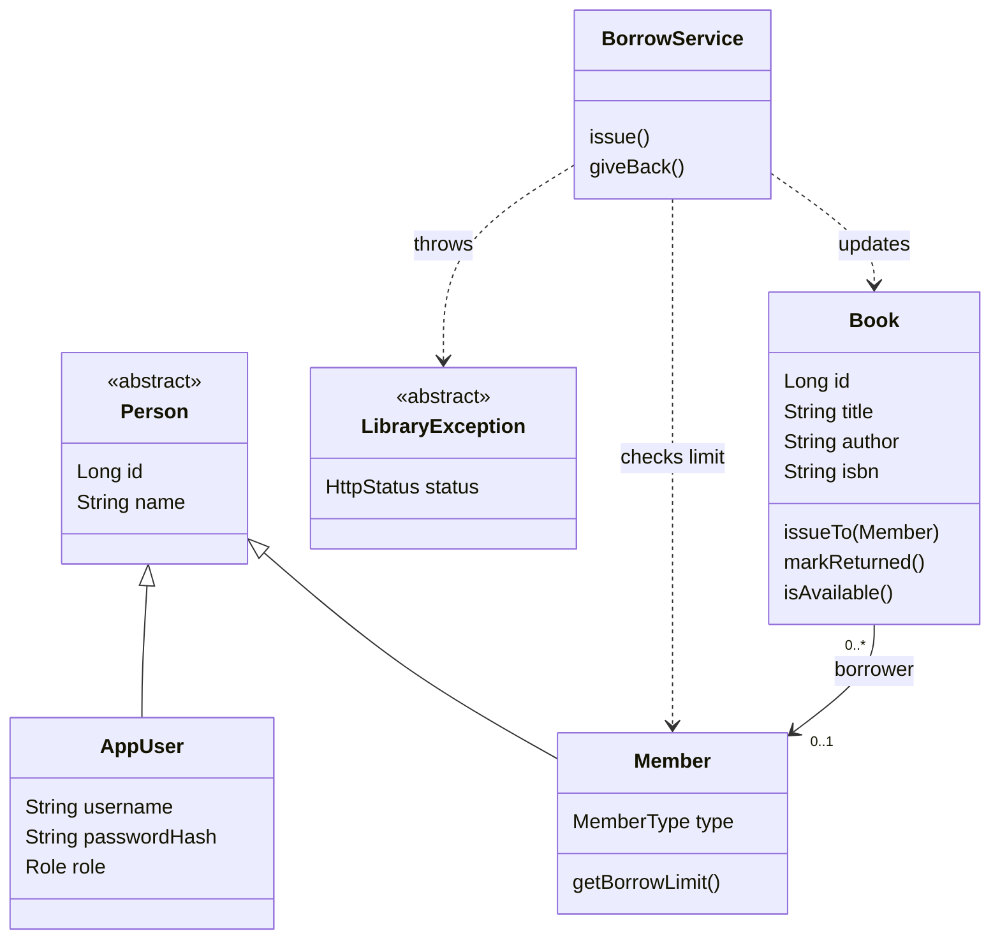
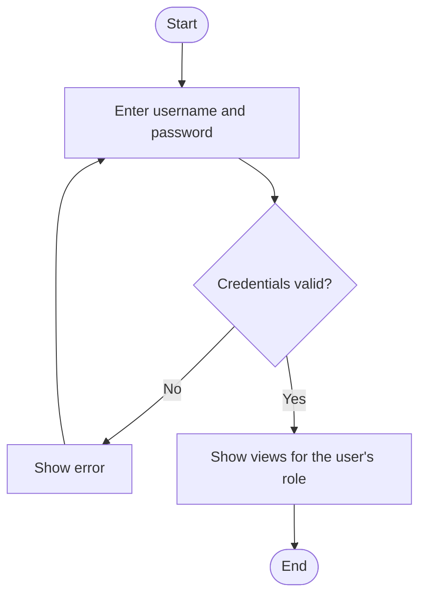
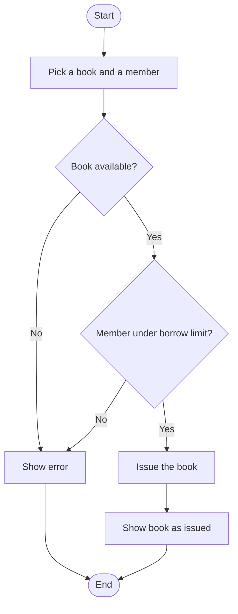

# Design Diagrams

Written in [Mermaid](https://mermaid.js.org/); they render on GitHub and in the VS Code Markdown preview.

## Class diagram

`MemberType` is `STUDENT` (limit 3) or `FACULTY` (limit 5). `Role` is `ADMIN`, `LIBRARIAN` or `MEMBER`.

## Activity diagram: sign in

## Activity diagram: issue a book

